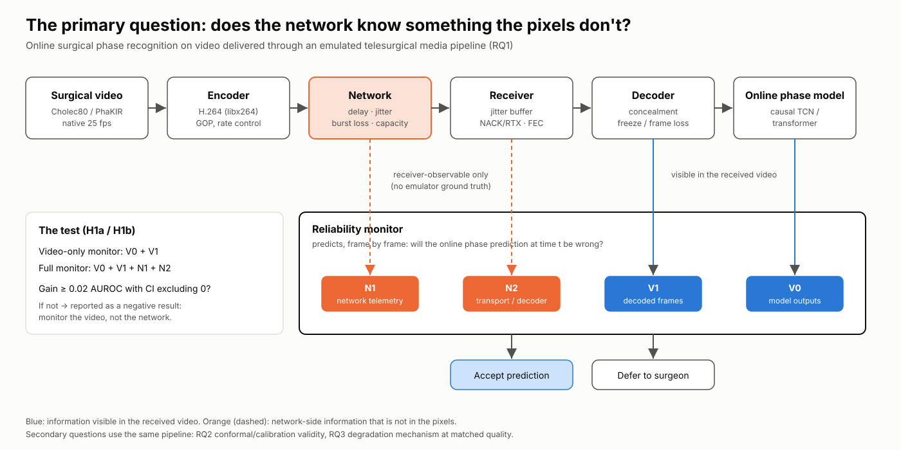
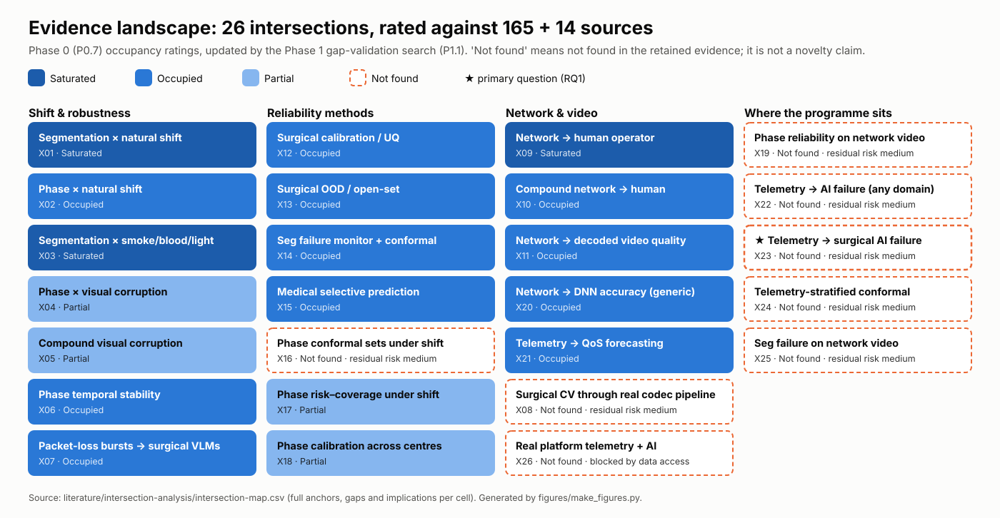
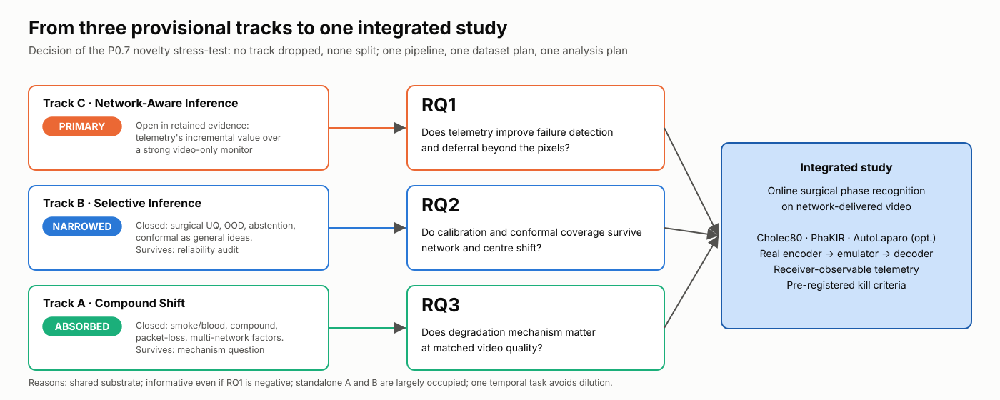
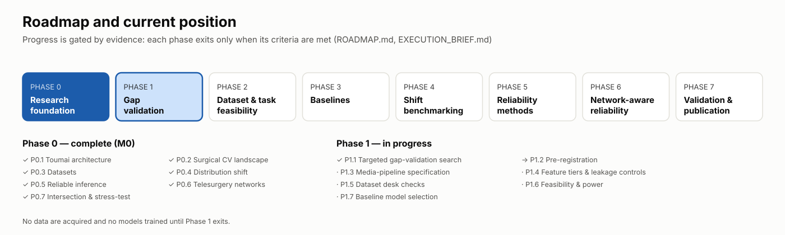
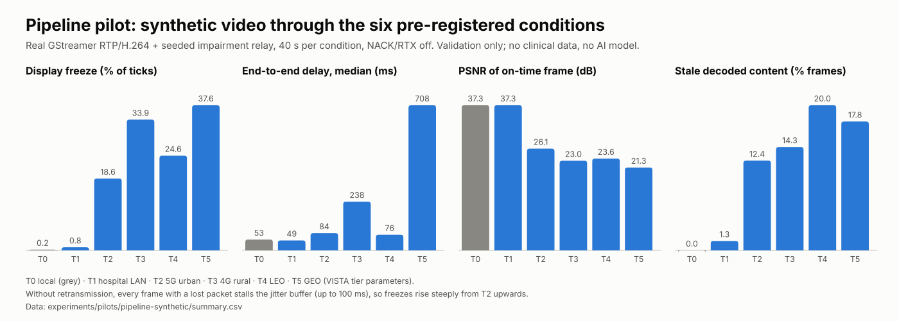

# Reliable Surgical Vision

**Reliable Visual Inference Under Distribution Shift for Robot-Assisted and Tele-Robotic Surgery**

When surgical video crosses a network to reach a remote surgeon (or an AI model), it can arrive compressed, frozen, late or damaged. This programme studies how computer-vision models used in robot-assisted and tele-robotic surgery can **stay reliable, or know when to step back**, when the conditions they see at deployment differ from those they were trained on.

> **Core question:** How can computer-vision systems used in robot-assisted and tele-robotic surgery maintain reliable inference, or safely abstain, when deployment conditions differ from those encountered during development?

| | |
|---|---|
| **Status** | Phase 0 complete (M0). Phase 1 deliverables complete: gap validated, study pre-registered and specified (M1 pending author sign-off). Phase 2 next. |
| **Evidence base** | 179 coded sources across surgical CV, datasets, distribution shift, reliable inference, telesurgery networking and adjacent fields |
| **Primary question** | Does network-side information improve failure detection for surgical AI beyond what is visible in the received video? |
| **Experiments** | No clinical data yet. The study is [pre-registered](research/integrated-study/preregistration.md); the media pipeline and analysis code are built and [validated on synthetic video](experiments/pilots/pipeline-synthetic/). |

---

## The research question in one picture



An online surgical **phase-recognition** model watches video that has passed through a real encoder, an emulated network and a decoder. A **reliability monitor** decides, frame by frame, whether to trust the model or defer to the surgeon. The decisive test compares two monitors:

- **video-only:** model outputs (V0) + decoded-frame evidence (V1);
- **video + network:** the same, plus receiver-side network (N1) and transport/decoder (N2) telemetry.

If telemetry adds no detectable value (pre-registered: an AUROC gain whose confidence interval excludes 0; 0.02 is the smallest gain of interest), the study reports a **negative result**: *monitor the video, not the network.* That answer is useful either way.

Two secondary questions use the same pipeline:
- **RQ2:** do calibration and conformal prediction sets tuned on clean video stay valid under network-delivered and cross-centre video?
- **RQ3:** does the *kind* of damage (freezes and frame loss versus compression) matter when overall video quality is the same?

Full statement and hypotheses: [`revised-research-questions.md`](literature/intersection-analysis/revised-research-questions.md).

---

## What the evidence says



Phase 0 mapped the field and rated 26 intersections of *task × shift × reliability method × network layer*:

- **Already well studied (blue):** surgical models failing across hospitals; smoke, blood and low-light robustness; surgical uncertainty, OOD detection and conformal prediction; how networks affect *human* telesurgeons and video quality; and, outside medicine, how networks affect AI accuracy.
- **Not found in the evidence base (dashed):** using network-side telemetry to predict when a surgical AI model is wrong, tested against a strong video-only monitor. A targeted follow-up search (P1.1) across video analytics, teleoperated driving, semantic communication, V2X and MICCAI 2026 still found no occupying study.

"Not found" is **not** a novelty claim. Each such cell carries a residual-risk rating; see the [intersection map](literature/intersection-analysis/intersection-map.csv) and the [gap-validation report](literature/gap-validation/gap-validation-report.md).

Notable neighbouring work the programme builds on rather than repeats: **VISTA** (surgical video-streaming benchmark under network impairment, human outcomes), **Endo-C6** (packet-loss bursts degrade surgical video-language models) and **TCSR-Monitor** (video-only failure monitoring for surgical segmentation).

---

## How the research tracks evolved



The programme started with three provisional tracks. A claim-by-claim [novelty stress-test](literature/intersection-analysis/novelty-stress-test.md) showed that each overlapped heavily with existing work on its own, but that together they point to one open question. They now form **one integrated study** ([decision record](literature/intersection-analysis/track-decision.md)).

---

## Roadmap



| Phase | Purpose | Status |
|---|---|---|
| 0 — Research foundation | Map architecture, field, datasets, shift, reliability, networking; stress-test novelty | **Complete** (`v0.0.1`–`v0.0.6`; P0.7 suggested `v0.0.7`) |
| 1 — Gap validation | Confirm the gap, pre-register, specify pipeline/features/datasets/power/baselines | **Deliverables complete**, pending sign-off ([integrated study](research/integrated-study/)) |
| 2 — Dataset & task feasibility | Acquire permitted data, verify licences, reproduce a baseline | Planned |
| 3–7 | Baselines → shift benchmarking → reliability → network-aware reliability → validation | Planned |

### Latest: pipeline validated on synthetic video



The media pipeline (real RTP/H.264 streaming through a seeded network-impairment relay) has been built and validated on synthetic video. Building it surfaced, and fixed, two silent faults that would have corrupted the study: hidden packet loss *before* the emulator, and a delay-inflating jitter model. Details: [pilot report](experiments/pilots/pipeline-synthetic/).

---

## Repository guide

| Path | What's there |
|---|---|
| [`literature/`](literature/) | Evidence base: one folder per reconnaissance task, plus the global map and bibliography |
| [`literature/intersection-analysis/`](literature/intersection-analysis/) | **Start here.** P0.7 integration, intersection map, stress-test, revised questions, Phase 1 plan |
| [`literature/gap-validation/`](literature/gap-validation/) | Phase 1 targeted search (P1.1) |
| [`datasets/`](datasets/) | Dataset registry, licences, provenance/overlap, splits, shortlist |
| [`research/`](research/) | The integrated study: pre-registration, pipeline/feature specs, feasibility, and the three work packages (former tracks A–C) |
| [`docs/architecture/`](docs/architecture/) | Toumai tele-robotic system architecture (public evidence) |
| [`figures/`](figures/) | Programme figures and the script that generates them |
| [`task-completion-report/`](task-completion-report/) | Formal closure record for every completed task |
| [`phase-task-files/`](phase-task-files/) | Task specifications |
| [`src/`](src/) · [`tests/`](tests/) | Pipeline (network emulation, RTP streaming, display clock), monitor features, statistics and conformal code; 38 tests |
| [`experiments/pilots/`](experiments/pilots/) | Validation pilots (synthetic data only so far) |

Programme files: [`EXECUTION_BRIEF.md`](EXECUTION_BRIEF.md) (standards), [`ROADMAP.md`](ROADMAP.md), [`TASK.md`](TASK.md) (active tasks), [`RESEARCH_LOG.md`](RESEARCH_LOG.md) (dated decisions), [`MEMORY.md`](MEMORY.md) (durable context), [`AGENT.md`](AGENT.md) (rules for AI-assisted sessions).

## Reproducing the generated artefacts
```bash
python3 literature/intersection-analysis/build_global_evidence_matrix.py   # coded evidence matrix + coverage summary
python3 figures/make_figures.py                                            # README figures
```
Both scripts use only the Python standard library. Pipeline code and tests need the pinned environment in [`requirements.txt`](requirements.txt):
```bash
python3 -m venv .venv && .venv/bin/pip install -r requirements.txt
.venv/bin/python -m pytest -q tests/
.venv/bin/python scripts/run_pipeline_pilot.py --seconds 40      # synthetic pipeline pilot (~6 min)
```

## Research principles
1. Evidence before novelty claims.
2. Reproducibility by design.
3. Clear separation of observation, hypothesis, experiment and conclusion.
4. Reliability evaluation beyond headline predictive performance.
5. Transparent reporting of negative and inconclusive results.
6. Safety-aware interpretation of medical-AI research.
7. Version-controlled experiments, configurations, results and decisions.

## Scope and safety
This is a research programme, not clinical decision support. Emulated network experiments do not establish clinical safety thresholds, and they do not describe the behaviour of any proprietary platform. No novelty or "first" claims are made ([claim audit](literature/intersection-analysis/claim-audit.md)).

## Author
Oyewale Daniel ([@Engr-Daniel](https://github.com/Engr-Daniel))
