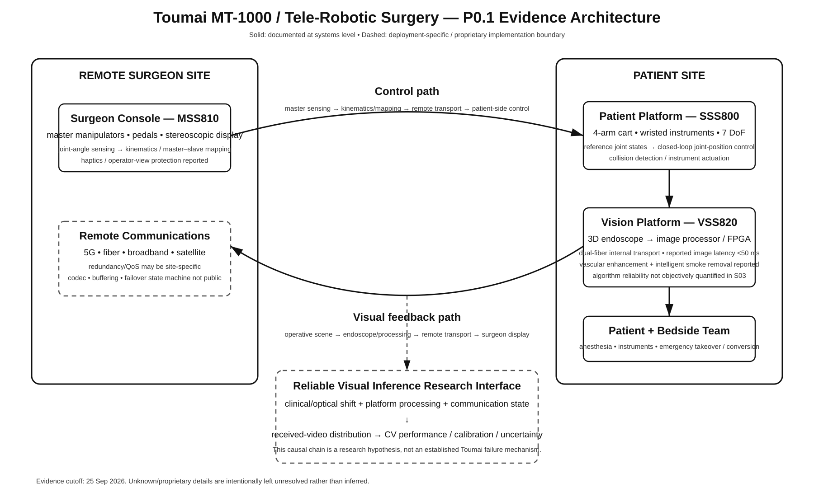

# Architecture

Public-evidence reconstruction of the Toumai MT-1000 tele-robotic surgical system (P0.1).

- `toumai-system-architecture.md`: full report (components, visual pipeline, teleoperation, communications, safety, relevance to reliable vision)
- `toumai-architecture.svg` / `.png`: evidence architecture diagram. Solid lines are documented at systems level; dashed lines mark deployment-specific or proprietary boundaries.

Evidence trail: `literature/toumai/`. Proprietary codec, network and failover internals are **unknown**. The programme's emulated pipeline is an abstraction, not a model of this system.
