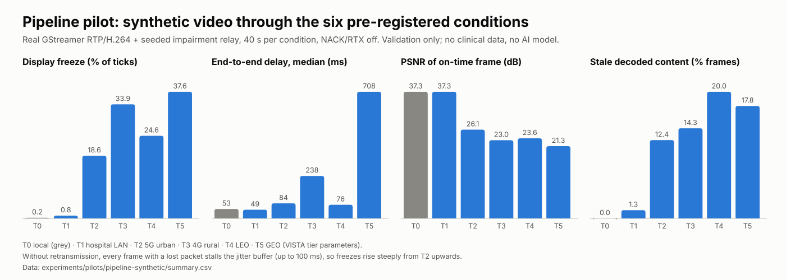

# Pilot P2.2 — Media-pipeline validation on synthetic video

**Date:** 2026-11-12 · **Data:** synthetic barcoded video only (no clinical data, no AI model) · **Script:** [`scripts/run_pipeline_pilot.py`](../../../scripts/run_pipeline_pilot.py) · **Results:** [`summary.csv`](summary.csv)



## Setup
Real GStreamer 1.24.2 RTP/H.264 sender (x264, zerolatency, GOP 25, CBR) → seeded user-space impairment relay (pre-registered conditions T0–T5) → receiver (jitter buffer 100 ms, `avdec_h264`) over localhost UDP. 40 s (1,000 frames) per condition, display clock reconstructed at 25 Hz with an 80 ms playout margin. **NACK/RTX off** (not yet implemented).

## Validation checks (pipeline-spec §6)
| Check | Result |
|---|---|
| (a) T0 passthrough reproduces the source up to codec quantisation | **Pass**: PSNR 37.3 dB, 1,000/1,000 frames, no freezes outside end-of-stream |
| (b) Realised loss ≈ configured | **Pass (directionally)**: T2 0.46 vs 0.5%, T3 1.69 vs 2.0%, T4 1.39 vs 1.5%, T5 0.60 vs 0.5%. With ~100 loss bursts per 40 s run, the expected sampling error is about ±10%, so the ±10% tolerance must be judged on full-length procedures |
| (c) Frame-index alignment 100% at T0 | **Pass**: barcode = RTP-derived index for 100% of frames |
| (d) No loss before the emulator *(added in P2.2)* | **Pass**: sender-counted RTP packets = relay-received packets in every condition |

## What the pilot found
1. **Two silent pipeline faults were caught and fixed before any study run.** Keyframe bursts overflowed the relay's socket buffer and dropped about 1.5% of packets *before* the emulator; this was invisible to the emulator's own ground truth. Separately, unpadded 3-byte BGR frames produced grey video. See pipeline-spec §9.
2. **Loss reaches the AI input in two different ways.** (i) *Stale content:* the decoder conceals lost slices with older pixels; 12–20% of decoded frames at T2–T5 show partly old content while carrying a correct frame index. (ii) *Freezes:* without retransmission, each frame with a missing packet stalls the jitter buffer for up to its latency, so the display holds frames. Freeze ticks reach 19–38% at T2–T5. Both are mechanisms RQ3 distinguishes.
3. **Delay follows the tier design**: median end-to-end ≈ 50 ms (LAN) to ≈ 710 ms (GEO).
4. **Receiver features respond to impairment** as intended: N1 loss fraction, jitter-buffer losses (N2) and pixel freezes (V1) all increase from T1 to T5.

## Limits
- 40 s runs are too short for tight loss-rate validation; full procedures (~38 min) will be.
- RTX off. The pre-registered primary condition has RTX on and is expected to reduce both freezes and stale content substantially, so **these degradation levels are not the study's operating point.**
- The freeze definition here (display holds at 25 Hz) differs from VISTA's (decode-failure events), so freeze rates are not comparable to VISTA's.
- Synthetic video (moving texture) compresses differently from surgical video.

## Reproduce
```bash
.venv/bin/python scripts/run_pipeline_pilot.py --conds T0,T1,T2,T3,T4,T5 --seconds 40 --raw /tmp/pilot_raw
```
Raw logs (≈ 30 MB) are not committed; the summary is.
