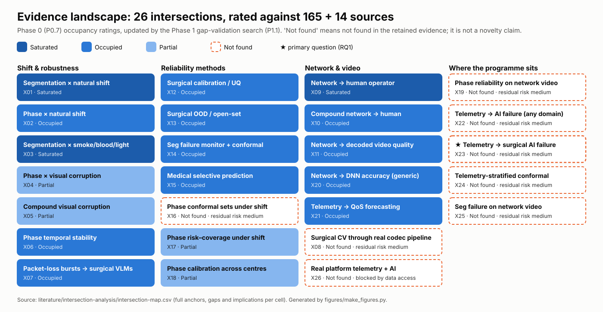

# Literature

The programme's evidence base. Every reconnaissance task has its own folder with a search protocol, screening log, source index, evidence maps, an `rq-answer-matrix.md` and `open-questions.md`.

| Folder | Task | What it answers | Sources |
|---|---|---|---|
| [`toumai/`](toumai/) | P0.1 | What is publicly known about the Toumai tele-robotic architecture | S01–S16 |
| [`surgical-vision/`](surgical-vision/) | P0.2 | Surgical CV tasks, models, metrics, benchmark practice | SV01–SV33 |
| [`../datasets/`](../datasets/) | P0.3 | Dataset access, licences, provenance overlap, splits | DS01–DS18 |
| [`distribution-shift/`](distribution-shift/) | P0.4 | Natural, visual, temporal and compound shift in surgical CV | SH01–SH25 |
| [`uncertainty-reliability/`](uncertainty-reliability/) | P0.5 | Calibration, UQ, OOD, failure detection, selective and conformal prediction | RI01–RI36 |
| [`telesurgery-networking/`](telesurgery-networking/) | P0.6 | Network → transport → codec → decoder → received video | NW01–NW35 |
| [`intersection-analysis/`](intersection-analysis/) | P0.7 | Integration, intersection map, novelty stress-test, revised RQs | IX01–IX12 |
| [`gap-validation/`](gap-validation/) | P1.1 | Targeted search for prior work on the primary question | GV01–GV14 |

## Programme-wide records
- `literature-map.csv`: one row per retained source (all tasks)
- `references.bib`: merged bibliography
- `intersection-analysis/global-evidence-matrix.csv`: every source coded on task / shift / reliability / network dimensions (generated)

## Rules
- Extraction fields: question, task, dataset, model, shift, reliability method, metrics, network variables, finding, limitations, relevance.
- Distinguish confirmed evidence, inference and open hypotheses; label manufacturer claims as such.
- "Not found in retained evidence" is never written as "novel" or "first".
