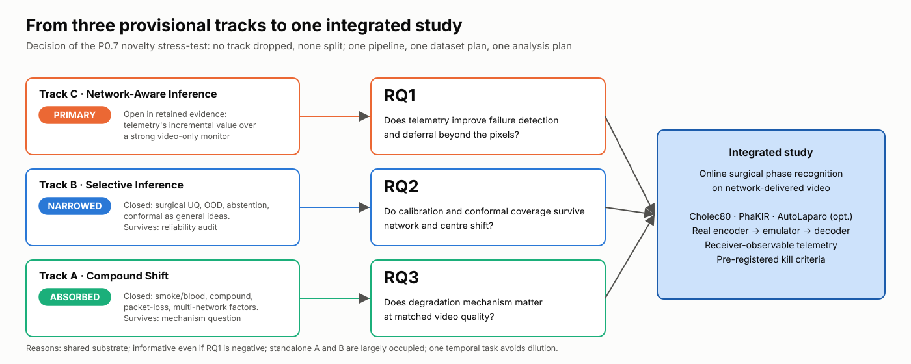

# Research

Since P0.7 (2026-11-12) the three provisional tracks are **work packages of one integrated study**.

| Folder | Role | Question |
|---|---|---|
| [`integrated-study/`](integrated-study/) | Study-level documents (pre-registration, pipeline spec, feature spec, feasibility) | RQ1–RQ3 |
| [`track-c-network-aware/`](track-c-network-aware/) | **Primary**: telemetry's incremental value for failure detection / deferral | RQ1 |
| [`track-b-selective-inference/`](track-b-selective-inference/) | Reliability layer: calibration and conformal validity under shift | RQ2 |
| [`track-a-compound-shift/`](track-a-compound-shift/) | Shift construction and degradation characterisation | RQ3 |

Each track folder contains `research-question.md`, `literature-gap.md`, `hypotheses.md` and `experiment-plan.md`.
