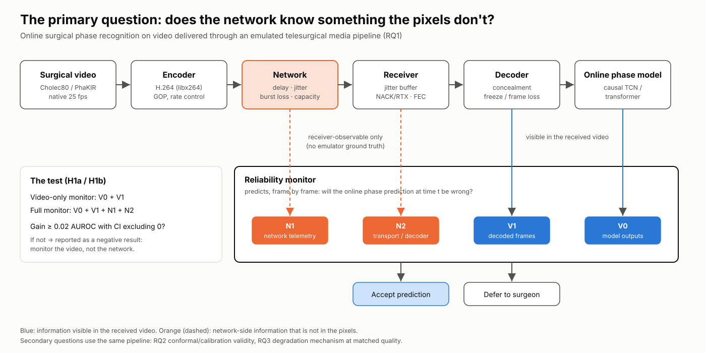

# Integrated Study — Telemetry-Aware Reliability of Online Surgical Phase Recognition

Created by P0.7 (2026-11-12) when Tracks A–C were merged ([decision](../../literature/intersection-analysis/track-decision.md)). Phase 1 turned it into a pre-registered, specified design.

| Question | Role | Work package |
|---|---|---|
| RQ1 | **Primary:** incremental value of receiver-observable telemetry for failure detection / selective deferral | [`../track-c-network-aware/`](../track-c-network-aware/) |
| RQ2 | Calibration and conformal coverage under decoder-mediated and natural shift; telemetry-stratified calibration | [`../track-b-selective-inference/`](../track-b-selective-inference/) |
| RQ3 | Mechanism-dependent degradation at matched video quality | [`../track-a-compound-shift/`](../track-a-compound-shift/) |

## Design documents (Phase 1)
| Document | Task | Content |
|---|---|---|
| [`preregistration.md`](preregistration.md) | P1.2 | **Frozen v1.0.** Data splits, impairment tiers, models, outcomes, hypotheses H1a–H3, tests, multiplicity, stopping and reporting rules, amendment log |
| [`pipeline-spec.md`](pipeline-spec.md) | P1.3 | Encoder → RTP → NetEm → jitter buffer → decoder; per-frame receiver log schema; reproducibility ("capture once, decode deterministically"); compute and storage |
| [`feature-spec.md`](feature-spec.md) | P1.4 | Exact V0/V1/N1/N2 features; six leakage controls with their unit tests |
| [`dataset-desk-checks.md`](dataset-desk-checks.md) | P1.5 | Cholec80 / PhaKIR / AutoLaparo access, licence, taxonomy, overlap |
| [`feasibility/`](feasibility/) | P1.6 | Power simulation (procedure-clustered bootstrap) and compute estimate |
| [`baseline-selection.md`](baseline-selection.md) | P1.7 | TeCNO (M1) and Surgformer (M2), pinned commits and licences |

## Key design facts
- **Data:** Cholec80 1–32 train · 33–40 validation/calibration · 41–80 test (40 procedures); PhaKIR (8, 3 centres) external and descriptive.
- **Conditions:** local reference plus five published network tiers (hospital LAN, 5G urban, 4G rural, LEO, GEO). RQ3 adds one-factor sweeps.
- **Monitors:** video-only (V0+V1, including a learned pixel→error predictor) vs full (+N1+N2), cross-fitted over five procedure-level folds.
- **Primary test:** ΔAUROC > 0 with a procedure-level BCa bootstrap CI (H1a; 0.02 = smallest effect of interest), co-primary with ΔAURC (H1b), Holm-corrected.
- **A negative result is a planned outcome:** "monitor the video, not the network."

## Status
Design complete pending Phase 1 exit review. **No data acquired, no models trained.** Implementation starts in Phase 2.
